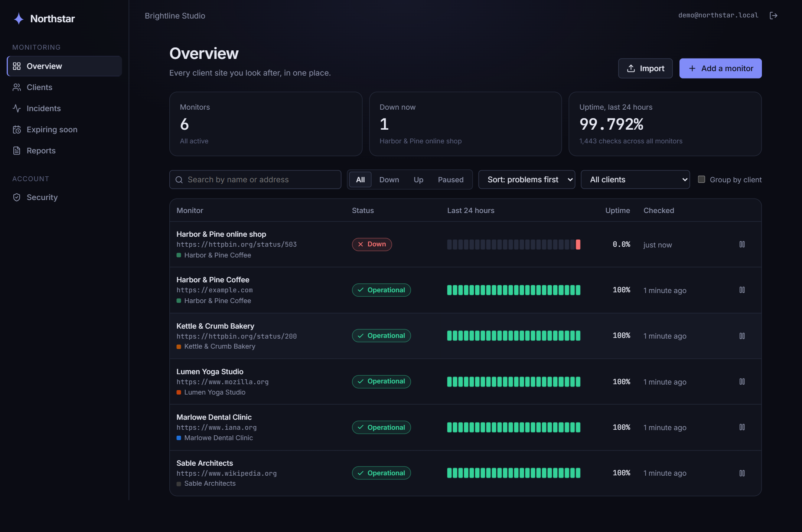
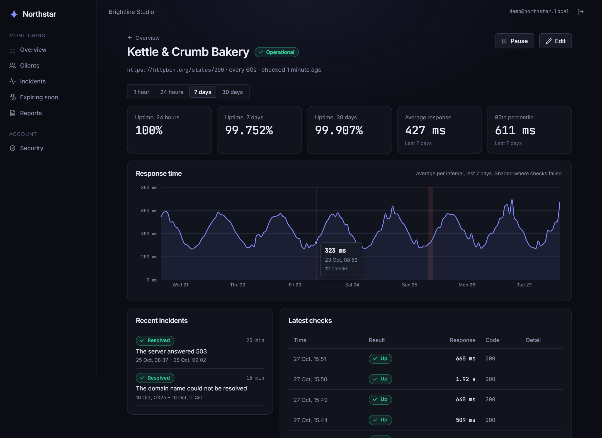
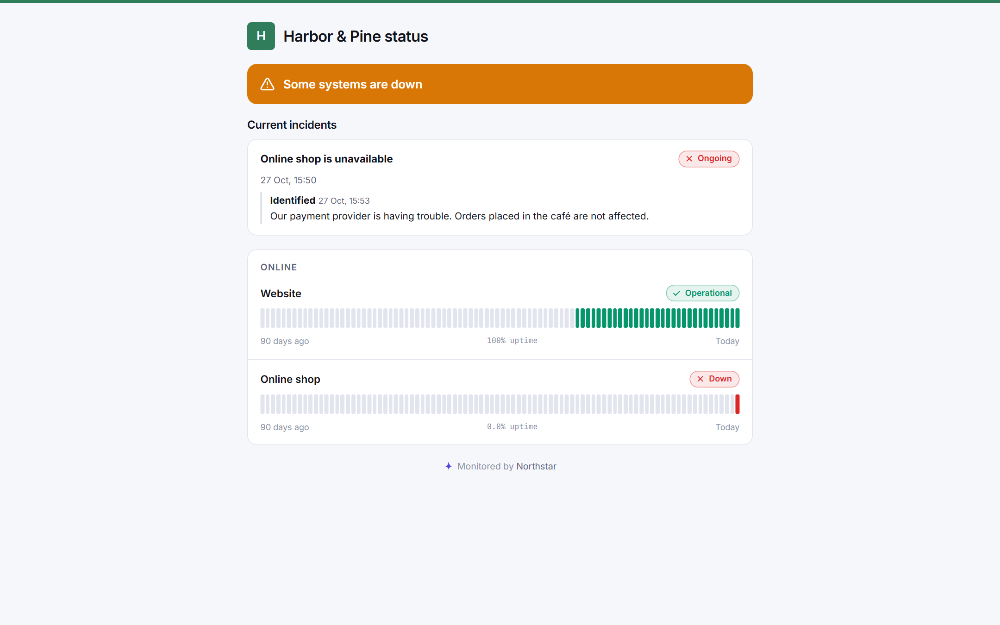
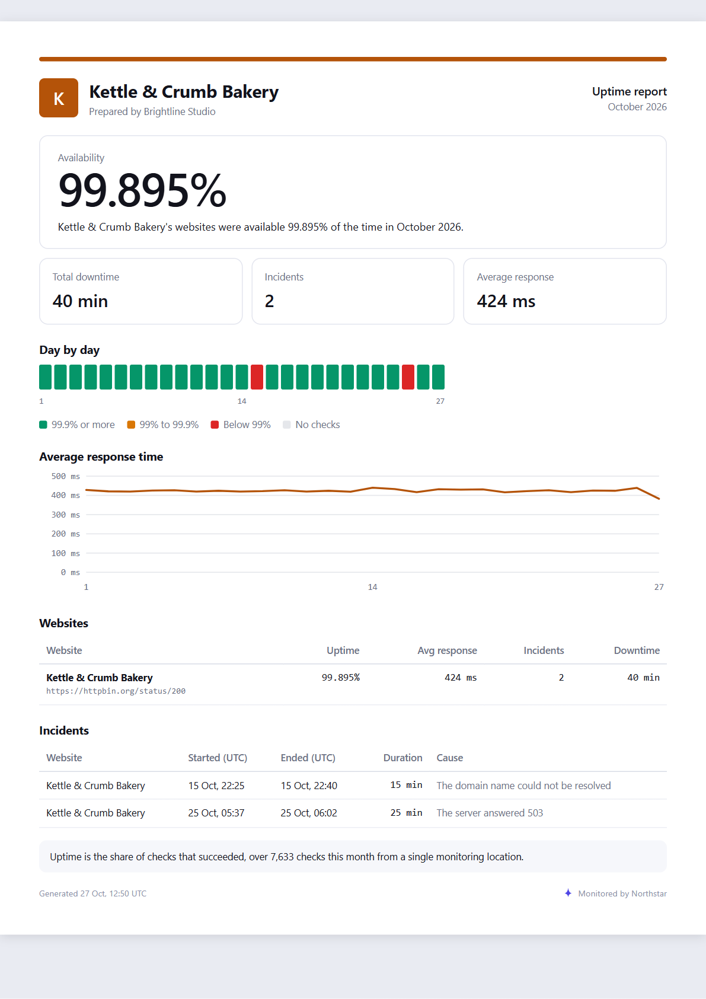
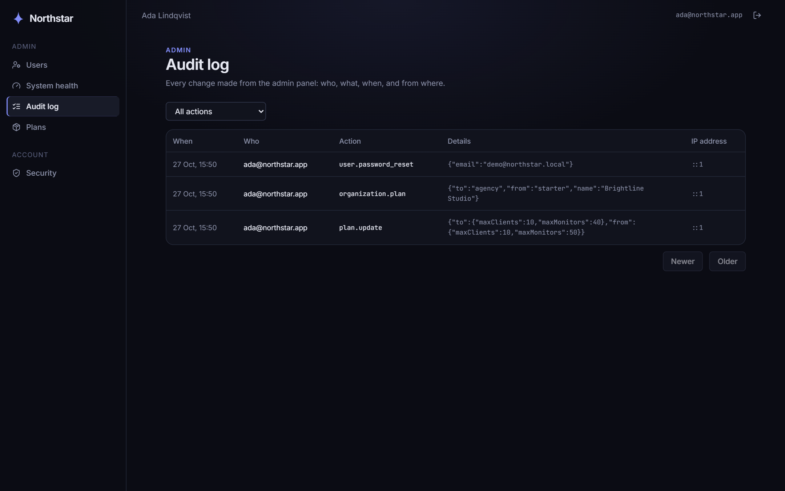
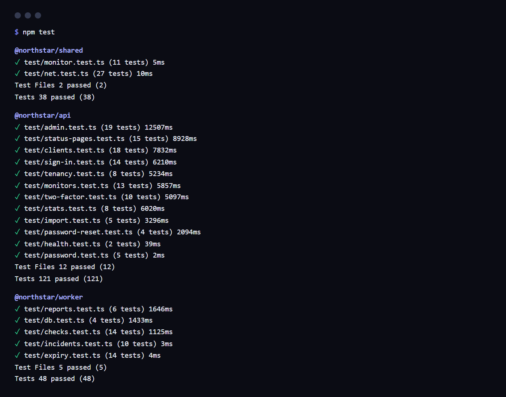

# Northstar

Uptime monitoring for agencies that answer to many clients.

Northstar watches every website an agency looks after, groups them by client, warns
before certificates and domains run out, and gives each client a status page in their
own colours and a monthly uptime report as a branded PDF.

**Not deployed yet.** [Deployment](#deployment) shows how to run it on a server and how
to check that it is up.

## The idea

A web agency with forty clients finds out that a client's site is down the worst
possible way: the client tells them. Certificates lapse on a Saturday because the renewal
went to someone who left; a domain expires because the registrar's reminder landed in a
shared inbox. And when a client asks how reliable their site has been, the agency has
nothing to show beyond "we haven't heard of any problems".

Northstar is built around the agency rather than the single site. Monitors belong to
clients, clients belong to the agency, and everything the agency needs to say to a
client is already in that shape: a status page the client's customers can open, a
report that says "your sites were up 99.95% of the time in October" and can be
forwarded as it is, and a read-only sign-in for the client's own staff that shows them
their sites and nobody else's.

## What a monitor guarantees

These hold for every monitor, and each is covered by tests:

- **A monitor is called down only after every attempt fails.** A check is retried up to
  the configured number of times, two seconds apart; one success is enough to call it up.
- **One alert per change, never one per check.** An outage opens one incident and sends
  one email; recovery closes it and sends one more. A monitor that stays down stays quiet.
  The monitor row is locked while a result is recorded, so two checks finishing together
  cannot open two incidents.
- **Planned maintenance is silent and does not count.** During a client's maintenance
  window checks keep running, nobody is alerted, and those checks are left out of every
  uptime figure, including the monthly report.
- **Nothing a customer types reaches our own network.** Every address is resolved and
  checked against private, loopback, link-local and reserved ranges, at the moment the
  socket connects, for every redirect. A name that changes what it resolves to between
  saving and checking is caught at connect time.
- **One agency never sees another, and a client never sees another client.** Every query
  for tenant data goes through one module, `api/src/tenancy.ts`, and filters are combined
  with it so that they can only narrow the scope, never widen it.
- **Certificate and domain warnings arrive once per threshold.** 30, 15, 7 and 1 days
  before expiry, each at most once per expiry date; a certificate first seen with five
  days left gets one email, not four.

## What is stored, and what is public

**Stored.** Postgres holds the following. Secrets are hashed or encrypted at rest:

| Table                                       | What it holds                                                        |
| ------------------------------------------- | -------------------------------------------------------------------- |
| `users`                                     | Email, argon2id password hash, role, encrypted TOTP secret, lockout  |
| `sessions`                                  | SHA-256 of each refresh token, the token it replaced, device and IP  |
| `organizations`, `clients`, `memberships`   | The agency, its clients, and who belongs where with which role       |
| `monitors`                                  | Name, type (http, keyword, ping), target, interval, timeout, retries |
| `check_results`                             | Every check for seven days: status, response time, code, error       |
| `check_results_hourly`                      | Older checks folded into one row per monitor per hour                |
| `incidents`, `incident_updates`             | Outages, their cause, and what the agency told the public            |
| `certificates`, `domains`, `expiry_notices` | Expiry dates, how they were found, and which warnings were sent      |
| `status_pages`, `status_page_monitors`      | Each client's public page and the services it lists                  |
| `maintenance_windows`, `reports`, `invites` | Planned work, generated PDFs, one-time client invitations            |
| `plans`, `audit_logs`                       | Plan limits, and every admin action with actor and IP                |

Checks are kept raw for seven days and then rolled up by the hour, at 03:00 UTC. Uptime
stays exact after the rollup, because it is a count; the 95th percentile of response time
becomes an approximation for anything older than a week.

**Public.** A status page needs no sign-in, so it is built to say only what the agency
chose to publish:

| Shown on the status page                         | Never leaves the dashboard                         |
| ------------------------------------------------ | -------------------------------------------------- |
| the public name the agency gave each service     | the monitor's name inside the agency               |
| up, down, maintenance, and 90 days of daily bars | the URL or host being checked                      |
| "Online shop is unavailable", with its times     | the technical cause ("connect ECONNREFUSED 10.0…") |
| the updates the agency posted                    | monitor and client ids                             |
| the client's logo, colour and page title         | everything about the agency's other clients        |

### What it cannot tell you

Being clear about the edges is more useful than claiming there are none.

- **It checks from one place.** Every check runs from wherever the worker runs. A site
  that is unreachable from our network but fine for its visitors will be reported down,
  and a regional outage elsewhere will not be seen.
- **It sees as often as it looks.** The shortest interval is 30 seconds and the default
  is 60. An outage shorter than the interval can fall between two checks, and detection
  takes up to one interval plus the retries.
- **"Ping" is a TCP connection, not ICMP.** It proves a port accepts connections, which
  is more useful for a web server and needs no special privileges.
- **Keyword checks read the first 2 MB of a page.** A phrase further down is not found.
- **Some registries publish no expiry date.** `.tr` among others has no RDAP service; the
  agency types those dates in by hand. A domain is attached to the client of the first
  monitor that found it, and stays there if that monitor moves to another client.
- **Anyone can lock an account for 15 minutes** by getting its password wrong five times.
  That is the price of stopping guessing; rate limits are kept in memory, so with several
  api instances each one counts on its own.
- **Signing up says whether an email is taken**, and addresses are not verified at
  sign-up. Sign-in, by contrast, gives the same answer whether or not an account exists.
- **Alerts go by email only**, to the person who created the monitor; expiry warnings go
  to the agency's admins.

## The dashboard and the status page

The dashboard is dark, quiet and built for scanning: the question it answers first is
"is anything broken right now?", so problems sort to the top, and every status is shown
with an icon and a word as well as a colour.



The overview lists every monitor with its last 24 hours as hourly cells. Hovering a cell
gives that hour's uptime and number of checks. Here the Harbor & Pine online shop has
just started answering 503, so it sorts first, the tile above counts one monitor down,
and its bar shows a single red hour after a day with no data.



One monitor over a chosen range. The range picker scopes every figure on the page at
once. The chart is a single line, so it needs no legend; hours that contained failed
checks are shaded behind it, which is how the outage on the 25th shows without a second
axis.



What Harbor & Pine's customers see at their status page. It is light whatever the
dashboard uses, because it carries the client's brand, and most brand colours were chosen
to sit on white. The shop is listed under the name the agency chose, the incident under
a title built from that name, and the only explanation is the one the agency posted.



The monthly report, rendered by headless Chrome from the same HTML shown here, with
JavaScript and the network switched off. Downtime is the length of each incident clipped
to the month, and planned maintenance is subtracted and stated at the bottom. On the 1st
of each month at 09:00 UTC every client gets last month's report by email, with the
agency's admins copied.



The platform admin panel lists users (with suspension and password reset links), system
health (queues, workers, checks and database size), plans and limits, and this audit log,
where every admin action is recorded with who did it, to whom, and from which address.

## Repository layout

```
shared/
  src/monitor.ts        monitor rules, shared by the api and the web form
  src/net.ts            the SSRF guard: private ranges and a checking DNS lookup
  src/fetch.ts          fetch that follows redirects one hop at a time
  src/queues.ts         queue names and job shapes the api and worker agree on
api/
  src/auth/             sign-in, sessions, two-factor, password reset, rate limits
  src/tenancy.ts        the one place that scopes queries to an agency or a client
  src/monitors/         monitor CRUD, statistics, CSV and sitemap import
  src/clients/          clients and their logos
  src/status-pages/     the public status API and the page editor
  src/reports/          queueing and serving monthly SLA reports
  src/invites/          invitations that create client sign-ins
  src/maintenance/      maintenance windows and public incident updates
  src/expirations/      certificates and domains by days left
  src/admin/            admin endpoints, system health and the audit log
  src/cli/              npm run admin:create
  prisma/               schema, migrations and the demo seed
worker/
  src/checks/           http, keyword, ping, certificate, domain (RDAP)
  src/incidents.ts      up, down and maintenance transitions
  src/record.ts         stores a check and applies the transition
  src/expiry.ts         daily expiry refresh and 30/15/7/1-day warnings
  src/rollup.ts         folds week-old checks into hourly rows
  src/reports/          report figures, HTML template, PDF rendering, monthly run
  src/notify/           alert emails
web/
  src/app/              the shell, navigation and routes
  src/pages/            the agency dashboard, clients, imports, reports
  src/pages/status/     the public status page
  src/pages/admin/      the admin panel
deploy/                 Caddy configuration for production
docs/screenshots/       images used in this README
```

## Requirements

| Component       | Version                             |
| --------------- | ----------------------------------- |
| Node.js         | 22.23.4 or newer, or 24.22.1+       |
| PostgreSQL      | 16                                  |
| Redis           | 7                                   |
| Docker          | any recent version                  |
| Chrome/Chromium | any recent version, for PDF reports |

The Node versions are the first releases with the October 2026 security fixes, and
`engines` in `package.json` says so. Chrome is not bundled: the worker uses the one on
the machine, found in the usual places or named by `CHROME_PATH`. The production image
installs Chromium.

## Running it locally

Start Postgres, Redis and Mailpit, which catches every email the app sends:

```bash
docker compose up -d
```

Create `.env` from the example and fill in the three secrets:

```bash
cp .env.example .env
node -e "console.log(require('crypto').randomBytes(48).toString('base64url'))"   # JWT_SECRET
node -e "console.log(require('crypto').randomBytes(32).toString('base64'))"      # ENCRYPTION_KEY
# and any password of 12 characters or more for SEED_DEMO_PASSWORD
```

Install, create the schema and load the demo agency:

```bash
npm install
npm run db:migrate
npm run db:seed
```

The seed creates `demo@northstar.local` with five clients, one site each, and thirty
days of history with a few short outages, so the charts have something to show on a
fresh database. Then start the api, the worker and the web app together:

```bash
npm run dev
```

The dashboard is at http://localhost:5173 and the emails at http://localhost:8025. To
watch a monitor go down, point one at a server on your own machine and stop it; that
needs `ALLOW_PRIVATE_TARGETS=true` in `.env`, which switches the SSRF guard off and is
meant for local use only.

Platform admins are created on the server, never in the browser:

```bash
npm run admin:create -- you@example.com "Your Name"
```

The command asks for a password, then draws a QR code for an authenticator app and
prints ten backup codes. Admins cannot enrol two-factor from the web app, so someone who
learns a new admin's password still cannot claim the account.

```bash
npm test
```



The api and worker tests run against a real Postgres, in a `northstar_test` database of
their own that is brought up to the latest migration before each run. They cover what
is easy to get wrong quietly: tenant isolation, including a client viewer asking for
another client's data; lockout and two-factor under parallel requests; one alert per
outage; the SSRF guard across redirects and IPv6; and the uptime arithmetic against
figures worked out by hand. With Chrome on the machine, one test also renders a real PDF.

## Deployment

One server runs everything: Postgres, Redis, the api, the worker, and Caddy, which serves
the web app, forwards `/api` to the api on the same host (so the refresh cookie stays
first-party), and fetches the TLS certificate.

```bash
git clone https://github.com/betulaydurmuss/Northstar.git && cd Northstar
cp .env.example .env
# set JWT_SECRET, ENCRYPTION_KEY, POSTGRES_PASSWORD,
#     NORTHSTAR_DOMAIN=status.example.com and WEB_ORIGIN=https://status.example.com
docker compose -f docker-compose.prod.yml up -d --build
docker compose -f docker-compose.prod.yml exec -it api node api/dist/cli/create-admin.js you@example.com "Your Name"
```

The api applies migrations before it starts. `TRUST_PROXY` is set to 1 for Caddy; it
must match the number of proxies in front of the api, or rate limits and audit IPs will
be wrong.

There is no public instance yet. The commands below were run against these same
containers on localhost, and show what a deployment answers when it is healthy:

```bash
curl -s https://status.example.com/api/health
```

```json
{ "status": "ok", "service": "northstar-api", "time": "2026-10-27T13:02:17.543Z" }
```

```bash
curl -s https://status.example.com/api/public/status/harbor-and-pine | jq '{statusText, monitors: [.monitors[] | {name, status}]}'
```

```json
{
  "statusText": "Some systems are down",
  "monitors": [
    { "name": "Website", "status": "up" },
    { "name": "Online shop", "status": "down" }
  ]
}
```

## Roadmap

| Stage | Work                                                                          |
| ----- | ----------------------------------------------------------------------------- |
| Done  | Secure sign-in, monitoring engine, dashboard, clients and imports             |
| Done  | Certificate and domain expiry, keyword monitors, status pages, SLA reports    |
| Done  | Client sign-in, maintenance windows, admin panel, audit log, plan limits      |
| Next  | A public deployment and live demo                                             |
| Next  | Checks from more than one region, so one network's trouble is not an outage   |
| Next  | Slack, Microsoft Teams and webhook alerts, routed per client                  |
| Later | TLS on demand for client status domains, and status page subscriptions        |
| Later | Verified email at sign-up, and lockouts that cannot be triggered by strangers |

## License

MIT. See [LICENSE](LICENSE).
